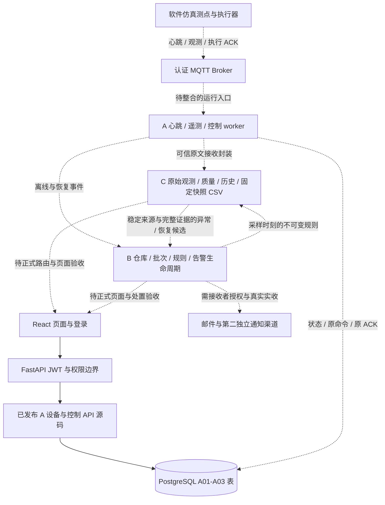
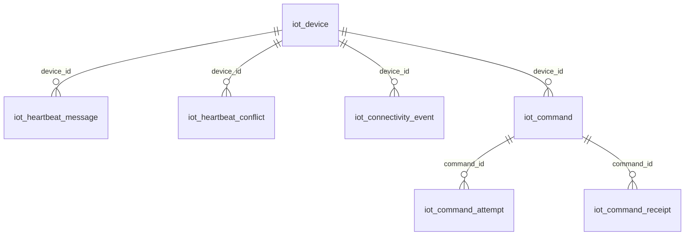

# A 提供的系统结构与数据库图底稿（M03，未签收）

2026-10-18；供 B 汇编设计文档、C 汇编测试报告使用。本稿说明已核对的代码结构、
物理约束和候选边界，不是“全系统已部署图”。最终图、截图与测试必须统一到实际
发布版；截止为 **10 月 30 日及之前实际投递**，不是只上传 GitHub。

## 1. 版本与读图规则

- 已审核发布的共同 main：`095c3a7b34ceacd4b9d52cbea180d77de596f2dc`，
  已含 A01 设备、A02 心跳持久化、A03 控制存储/API 源码，唯一 Alembic head
  为 `a03_control_storage`。源码发布不代表三台电脑数据库已升级或 worker 已启动。
- A 控制通信候选 PR18：`ed48ddbfec7a2de7440ab3a6472484062a94cf24`；
  A/B 根接线运行候选：`52ed0ea9fe9e7534e8005ff0d2a8f9b392e725ee`，
  其补证据提交为 `523f5fa1607cac6bc8ba595de0f276594ac4a646`。
- A 连续事件/遥测候选 PR28：`0d115bb20f186bd9b1e176e8ab846e7c4701d9e7`，
  已同步 B `7b1cf26d9ad1e7ec52b41654550ad2615bc097f9` 的修复；
  遥测实链脚本另挂固定 C 快照 `6d05d75d58dc23de48872ba2985a8f129c35ae49`，
  A 源码树不含 C 模块，不能称为最新 C HTTP/outbox 已整合。
- C 最新专项实测来源：`a97b9c04ff9cb3cd32872e87335b11bfadf677e1`。
  B 后续恢复增量 `9cf9a5de55d48bf0761655b6f2cda844ec5975f6` 有两项
  实测审查阻断，见 PR10 review `5563581508`，没有放入上述 A 联调版本。
- 三方接受的接口包固定为 `f98e65b4717334bae34f7495181c320ae5061860`；
  目标已签 3/3，PR23 审核发布/各人取得记录仍按 #5 收口。

以下实线表示已发布源码的结构依赖，**不表示生产进程已部署**；虚线表示候选
或仍需整合验收的路径。实际完成情况以[同日测试摘编](A-test-record-2026-10-18.md)
及 #5/#6/#7/#8/#9 为准，不把箭头本身当作运行证据。

## 2. 结构与责任

A 负责可信设备身份、协议/MQTT、心跳、控制、自己的持久队列以及共享根路由/
导航/运行交付；B 负责仓批规则、告警处置恢复、两渠道与本人页面；C 负责 raw/
质量、历史/CSV、候选可靠投递、本人页面及测试数据。模块 router 不重复 `/api/v1`。
没有正式 C 迁移前，不把 C 候选 router 直接当成生产入口挂载。

设备登记不等于在线；在线不等于温度正常；Broker 接收不等于设备执行；
B 持久接收不等于通知实收。以上四种区别必须在界面、设计和视频中一致表达。

## 3. 已发布 A 部分物理 ER

来源为上述 main 的 A01/A02/A03 迁移与对应模型。这是 **A 的七张 IoT 表**，
不是最终全系统 ER；模板的 User/Item、B/C 正式表须在最终版本按实际迁移另补。

| 表 | 主键/重要证据 | 实际数据库约束与限制 |
|---|---|---|
| `iot_device` | UUID；唯一编号、类型、仓库 UUID、可信最近心跳/连接状态 | unknown/online/offline；非 unknown 须有心跳历史；offline 须有原离线引用 |
| `iot_heartbeat_message` | device_id + message_id；规范指纹、接收时刻、结果 | 设备 FK，删除行为 CASCADE；只存 accepted/out_of_order |
| `iot_heartbeat_conflict` | device_id + message_id + fingerprint；冲突接收时刻 | 设备 FK，CASCADE；不覆盖原消息 |
| `iot_connectivity_event` | source_event_id；设备/仓、kind/reason/发生时刻、原异常引用与投递状态 | 设备 FK，CASCADE；offline/recovered；pending/held_unbound/delivered/failed |
| `iot_command` | command_id；actor/device/warehouse、不可变原包、期限、租约和终态 | 设备 FK 为 RESTRICT；每设备最多一条 queued/sent；1—300 秒、最多 10 次尝试 |
| `iot_command_attempt` | attempt_id；命令、开始/完成和传输结果 | 命令 FK，CASCADE；pending/accepted/transient/permanent |
| `iot_command_receipt` | command_id + fingerprint；执行/接收时刻、结果和 accepted/late/conflict | 命令 FK，CASCADE；重复回执不覆盖原终态 |

图中不能额外画出不存在的外键：`warehouse_id` 当前没有指向 B 仓库的物理 FK；
command.actor_id 是保留历史的 UUID，不是 User FK；connectivity 的原异常 UUID
也不是自关联 FK。B 仓库存在性由真实服务查询校验，暂时读故障不能当“不存在”。
迁移中的 CASCADE 不授权日常操作删除设备；当前业务不因此新增设备删除入口。

候选 A 遥测 admission/dispatch、C 隔离 metadata 及 B 状态转换表不能画进“已经
发布的物理 ER”。正式唯一链仍需 B 接实际 a03，再由 C 接已发布 B head，之后补
其它已审核扩展；不能把测试 create_all 或并行 Alembic head 说成正式迁移。

## 4. 核心数据和失败路径

1. 设备身份/主题由服务器核验；A 保存 exact raw 和服务器 received_at，与设备
   sampled_at 分开，重试保留原 reception/source 身份。未知/坏质量不能冒充正常。
2. 心跳可信提交后才续在线；离线一次生成稳定事件，恢复使用新 ID 引用原异常。
   未绑定事件保持 held_unbound，不在后来绑定后静默补造成一条新历史。
3. 控制先保存原命令、提交租约，再发网络；sent 只表示传输接受，可信原 ACK
   才能 acknowledged；timeout 后晚 ACK 留证而不改成功，不用新 ID 绕过不确定投递。
4. C 原始观测/质量与候选持久化后，B 按 source 和规范摘要判新/重复/冲突。
   临时故障用原身份有界重试；恢复以原异常规则为准，不能重写原异常等级/规则。
5. 历史页/详情/计数/CSV 均鉴权；同 actor/筛选/snapshot 的固定成员一致。
   超时、容量、未知、坏质量与空结果分别表达，不能用空列表掩盖存储失败。

## 5. 交付与最终更新责任

默认先交可复现本地应用，不要求购买云服务器；公开源码不是上线部署。
源码/依赖锁/模板许可证、启动/停止/安全配置说明和脱敏样例一并保留；真实凭据、
数据库、私人 work/原日志不得进入包。第二电脑必须从交付物实际启动和演示。

本稿可先供 B 编写需求/结构、供 PPT 方案部分引用；最终由 A 更新主程序与 ER，
B/C 补本人正式表/接口与实收/页面证据，三方复核同一发布 SHA 后才签 M03。
两库三批十四设备、两渠道实收、完整 E1、第二机、最终运行包/PPT/视频与实际投递
仍未在本稿中验收。材料应准确反映团队工作与辅助工具，不编造纯人工开发或测试。
