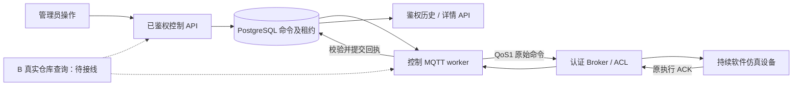
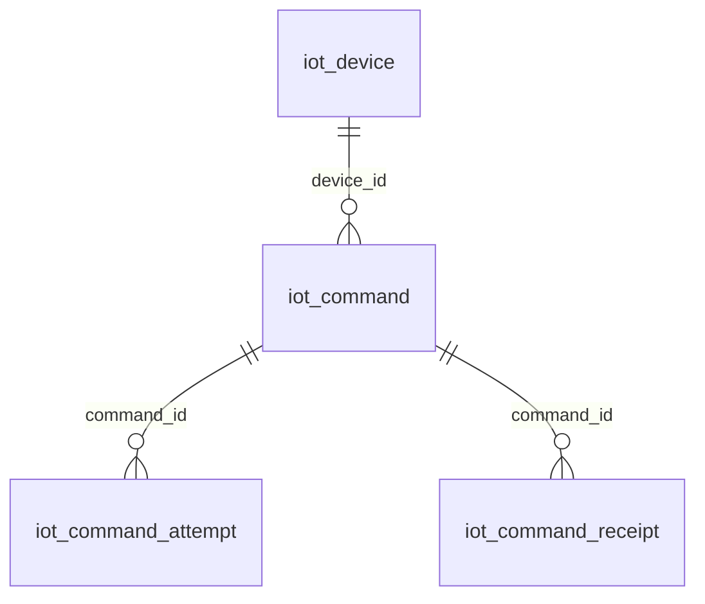

# A 设备与控制设计章节底稿（未签收）

2026-10-15。供B汇编M03软件设计文档、C汇编测试报告使用，不是最终发布说明。
本章源码依据为[PR18 / 53833a7921fbf700a3f945de449646cdc3d88b2d](https://github.com/Cynthia060913/freshlink-zhikong-public/pull/18)，
依赖[PR13](https://github.com/Cynthia060913/freshlink-zhikong-public/pull/13)。共同main
`f7fe62a95eceee75bebba3e135fc67d6c7728643`尚不含这些待审业务候选。
最终合并和联调后必须更新图、接口、证据和版本，不将本章直接充当整系统已交付。

## 1. 需求与责任

本系统使用软件仿真设备，不要求自制硬件。设备模块提供登记查询、可信心跳状态、
离线/恢复记录，以及管理员控制、设备执行回执和命令追溯。先验证一测点一执行器，
随后扩展两冷库、三批同品种苹果、十四逻辑设备；本轮未完成全量场景验收。

“在线”只表示服务器近期收到可信心跳，不表示温湿度正常；“已登记”“Broker接受”
和“设备执行成功”是不同事实。原始观测存储/质量/历史导出由C负责，仓库/规则/
告警和两种实际通知由B负责，A不得用测试替代冒充实际B/C接线。

## 2. 控制子系统结构（候选，不是当前生产部署图）

FastAPI复用模板的活跃用户和管理员认证。创建控制需要管理员、可信在线设备、
有效仓库绑定；发送前再核验权限和绑定。缺B真实仓库lookup时默认503，不接受任意UUID，
不在真实入口中使用恒True。仿真执行器按命令更新软件制冷状态，影响后续温度与功率；
这不是实物冷库的品质、能耗或节能实验。

命令先入数据库、领取租约并提交，再做网络发送；MQTT回调单owner处理，执行ACK先
校验和提交再手动确认。连接池、SQL、网络连接均有等待限制，重连和发送尝试有界。
数据库故障不返回虚假成功；日志使用固定原因，不输出凭据、DSN和原始敏感包。

## 3. 实际控制表关系

| 表 | 标识与作用 | 约束/边界 |
|---|---|---|
| iot_device | UUID；编号/名称/类型、绑定、最近心跳和连接状态 | 心跳身份不由客户端任意指定；控制只面向执行器 |
| iot_command | command_id；操作者/设备/仓库、原命令包、期限、状态、租约、终态 | 每设备最多一条queued/sent；设备FK为RESTRICT；actor_id是历史UUID，**不是User外键** |
| iot_command_attempt | attempt_id；一次发送尝试和传输结果 | command_id外键；pending/accepted/transient/permanent；Broker接受不是执行 |
| iot_command_receipt | command_id＋规范指纹复合主键；执行/接收时间和原结果 | 同ACK不重复插入；不同ACK保留冲突/late证据，每命令最多32种 |

控制候选沿A01→A02→A03迁移；正式共享链仍由A协调B、C依次接已合并head。
warehouse_id此时未建立B仓库外键，不能从上图推断跨模块完整ER已经实现。
`actor_id`不随账号删除抹去历史，但每次投递仍需操作者当前有效管理员权限。
时间字段保存UTC带时区；页面显示北京时间，不能覆盖数据库原时间。

## 4. API、状态和重试

| 操作 | 路径 | 权限/含义 |
|---|---|---|
| 创建/同意图重放 | POST /api/v1/devices/{device_id}/commands | 活跃管理员；201表示命令记录，不表示执行 |
| 历史 | GET 同路径，skip≥0、limit 1—100 | 活跃用户只读；按issued_at和command_id倒序 |
| 详情 | GET 同路径/{command_id} | 活跃用户只读，含执行回执；跨设备/未知404 |

请求为UUID command_id、action=set_cooling、布尔enabled、1—300秒lifetime_seconds。
event_id当前只允许null，直到B告警引用存在性/同仓校验接好，不能任填告警ID。
相同ID/操作者/设备/参数返回原命令和原期限；同ID改内容409，不能用新ID逃避不确定投递。

queued表示保存待发送；sent只表示Broker接受；acknowledged需要合法设备执行ACK；
明确失败为failed；到期未确认则timeout。迟到ACK可以留证但不把timeout改成功。
原命令重放由仿真器持久去重，返回原ACK，不重新执行。设备当前开关状态不能仅凭历史
ACK推断，重启后的当前状态仍需要可信观测；控制页面尚未完成。

每设备一次活跃命令、最多10次尝试，原TTL不延长。断线重建MQTT客户端，避免易失发送
队列绕开数据库租约。旧命令在期限内投递不确定时，不允许立即下反向命令。

## 5. 已验证与交付前差距

实际测试见[A测试记录](A-test-record-2026-10-15.md)。本轮完成局部控制实链和进程重启恢复，
不是E1。生产TLS/ACL配置、实际B仓库/告警依赖、C观测事务、控制页面/浏览器专项、
两种通知真实收件、十四设备、第二台电脑从交付物复现仍待完成。

最终材料必须引用同一发布版本，补充真实全系统架构/ER、运行环境和截图；保留模板许可证
和来源，准确说明团队新增部分。章节由A负责核对，B/C可直接引用已验证部分，不编造
纯人工开发经历、实物效果、收件记录或未运行的测试。M01—M05仍未签收。
